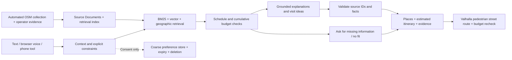

# Qala

An Astana walking companion for the **Build with AI** hackathon. Choose a starting landmark, a time budget and a mood. Get one to three sourced places, a concrete activity at each stop, and a walking itinerary. The planner estimates a budget first; the current interface checks it again against real pedestrian street routing before directions can start.

The current **Qala v2** interface uses Assistant UI, OpenUI, Phosphor icons and one embedded MapLibre/OpenFreeMap map. All **6,504 ordinary-visible POIs** are available as GPU clusters and selectable points, with a keyboard-searchable catalogue. Opening a venue shows its real available photos, reported facts and on-demand 2GIS rating without replacing the active route. True 2D and footprint-based 3D share the same canvas, selection and opt-in GPS. These schematic extrusions are not verified landmark models or photogrammetry. 2GIS supplies source profiles; it does not render the map. [Catalogue implementation and proof](docs/research/catalog-map-2026-10-20.md).

Current submission materials: [Russian presentation](artifacts/presentation-ru.pptx), [presentation PDF](artifacts/presentation-ru.pdf), [six-minute pitch](docs/pitch-script-ru.md), [five scenarios and evidence limits](artifacts/scenarios-and-limits-ru.pdf), [Russian demo](artifacts/video/ru/qala-demo-ru.mp4), [captions](artifacts/video/ru/qala-demo-ru.srt), and [submission checklist](docs/submission-checklist-ru.md). The export and archive verification reports record which final files have actually passed their completion gates. YouTube publication is tracked separately.

## Run

Requires Node.js 22+, npm, Python 3.11+ and [uv](https://docs.astral.sh/uv/). The collected dataset is included. **The grounded local planner needs no API keys.** Map tiles and pedestrian directions require network access to their configured services.

```sh
npm ci
uv sync --frozen
bash scripts/dev.sh
```

Open **http://localhost:5173**. The API runs at http://localhost:8000 and its interactive schema at http://localhost:8000/docs. Planned visit times and sample landmark coordinates are labeled in the UI. “Now” uses the current Astana time. Browser geolocation runs only after an explicit click.

For a single-port production build:

```sh
npm run build
uv run uvicorn backend.main:app --host 127.0.0.1 --port 8000 --no-access-log
# Open http://localhost:8000
```

Or use the included non-root container and persistent preference volume:

```sh
docker compose up --build
# Open http://localhost:8000
```

Stop the container with `docker compose down`. Delete the preference volume explicitly with `docker compose down -v` when you intend to erase it. The Compose service binds to the local computer by default.

## What works

- Five brief scenarios: a short walk, quiet coffee, a family outing, preflight planning and a late activity.
- English, Russian and Kazakh recommendations, assistant and map copy; location selection, planned departure time, group size, indoor and source-reported wheelchair filters. Several redesigned controls and evidence/route labels still use English.
- A real LangGraph execution graph, LangChain source Documents and vector retrieval, BM25 retrieval, geographic ranking, and deterministic budget/schedule validation.
- An automated citywide snapshot of **6,505 sourced POIs**: 6,223 OpenStreetMap records, 258 additional Overture destinations and 24 Wikidata landmarks, with raw collection evidence, per-source licences and separately sourced operator hours for the National Museum and Baiterek.
- On-demand **2GIS source profiles** using the user's server-side key: organization identity, separate rating/review counters, weekly schedules and available contacts. Photo and review buttons open the corresponding provider pages; provider content does not replace the licensed gallery or enter the open corpus. [Setup and scope](docs/research/map-api-setup.md), [source verification](artifacts/twogis-source-verification.json).
- A responsive Assistant UI conversation with native message editing, regeneration and version navigation, actual SSE retrieval progress, cancellation, an accessible composer, and Phosphor/shadcn controls. OpenUI renders grounded itinerary cards, comparisons, clarification choices and editable time/group/accessibility forms with working map, source and save actions.
- Embedded keyless MapLibre/OpenFreeMap 3D with exact route overlays, numbered places, selection and GPS. The 2D/3D button keeps one map instance; 2D hides every extrusion and locks pitch at zero. Building shapes and heights depend on the source data and do not reproduce detailed landmark architecture.
- Real Valhalla pedestrian street geometry, turn instructions, GPX export and optional browser GPS following. Updated street-route totals feed the current assistant plan, cards and itinerary; pending, stale and over-budget plans cannot start directions.
- Consent-only preference memory with explicit editing, inspection/deletion and 30-day expiry; conversational constraints remain on the active client branch. Raw messages and exact user coordinates are not stored in the preference database.
- **16 selectable spoken languages** for ElevenLabs conversation, independently of the EN/RU/KK planner and selected interface language. Some Kazakh shell labels still fall back to English. The configured presets and private-session issuance were verified against the actual provider. This is configuration proof, not sixteen completed conversations or a pronunciation study. Dictation retains its three supported application languages. [Multilingual voice](docs/research/multilingual-voice-2026-10-20.md), [replacement-account verification](artifacts/voice-new-account-verification.json). The signed Twilio inbound adapter calls the same planner; a real telephone call is unverified.
- City-level Open-Meteo weather and a dated Astana Venue Management calendar feed. Weather can suggest an indoor preference while preserving explicit user constraints. Event answers link to published dates; one operator's calendar does not cover every event or establish tickets, venue coordinates or admission.

The private local configuration enables **AlemPlus** grounded presentation selection, reranking and dictation, plus a private **ElevenLabs** agent. The [current API readiness report](artifacts/api-readiness-2026-10-20.json) verifies actual provider operations and distinguishes them from configuration and remaining quotas. [AlemPlus live checks](artifacts/alemplus-readiness-2026-10-20.json) cover all five adapters, three graph languages and two real speech fixtures. OpenAI returned HTTP 401 and is not selected; that response establishes an authentication failure, not quota exhaustion. The running retrieval index is the explicitly prewarmed local neural model; the portable distribution can use its documented lexical fallback. No credential values are included in reports or browser bundles.

The default embedding is explicitly a local feature-hashed lexical vector with multilingual interest expansion. It is **not a pretrained semantic model**. A prewarmed local multilingual MiniLM model provides real neural embeddings without an API key (`QALA_EMBEDDINGS=local`); the runtime loads its cache without network access. See [the neural setup](backend/README.md). `QALA_EMBEDDINGS=openai` remains an optional cloud alternative. Optional model assistance selects strict presentation enums for evidence focus, introduction style and category-appropriate action. All visible explanations/actions are rendered from trusted localized templates; arbitrary model prose never enters the response. Valid selections use `llm-assisted` mode; invalid provider output falls back to grounded local responses.

## Current assistant and dataset upgrade

The supplied [brief has been reread and retained](docs/challenge-brief-current.txt). The composite corpus contains **6,505 POIs**, including 4,300 named records, 1,893 reported schedules and 167 records with wheelchair access listed as yes. It preserves all 6,222 original OSM IDs, adds one independently sourced Alem.ai exterior record, 258 filtered Overture destinations and 24 Wikidata landmarks. Source IDs, release dates, coordinate precision and matching decisions remain inspectable. City-polygon checks, branch identity checks and quarantine exclude collapsed coordinates and ambiguous duplicates.

There are **83 licensed photograph assignments across 61 places**, using 78 unique real image assets, and **one signed Mangrove rating** without opinion text. On-demand 2GIS statistics stay separate from this open corpus. Exact entity identities and reviewed source descriptions link photographs to venues; nearby buildings and chain logos are not substitutes. The [current inventory/file audit](artifacts/media-inventory-final.json), [retained earlier source audit](artifacts/media-source-verification-current.json) and [new acquisition/identity research](docs/research/media-expansion-2026-10-20.md) define their scopes. The dataset is a sourced city snapshot, with partial photo/review coverage. [JSON](data/pois.json), [CSV](data/pois.csv), [GeoJSON](data/pois.geojson), [manifest](data/dataset-manifest.json).

The former **Nur Alem Museum of Future Energy** remains a historical Overture entity, marked `closed` and excluded from recommendations and default search after its operator confirmed that it stopped receiving visitors in December 2024. Its original name, ID and source are preserved; it is not renamed into the newer museum. The [bounded operator evidence](data/raw/operator-corrections-2026-10-20.json) is reapplied during refresh/replay. `GET /api/pois?include_closed=true` and lookup by ID retain the auditable record. [Runtime correction checks](artifacts/provider-crawl/operator-correction-runtime.json).

The separately acquired **Alem.ai** record represents exterior viewing of the original OSM office-building identity. Museum of Singularity is a visitor component with its own reported schedule; it does not establish whole-building opening hours or turn the former museum into a current attraction. Its evidence is replayed from portable, versioned source sidecars.

```sh
uv run python scripts/refresh_dataset.py --replay
# Verify and reproduce normalized data from the retained source snapshots.
uv run python scripts/refresh_dataset.py --live
# Refresh OSM, media and reviews, reapply retained additions and operator corrections,
# validate and publish the normalized files transactionally.

uv run --extra collection python scripts/refresh_dataset.py --live --overture
# Also refresh the selective Astana Overture snapshot (optional DuckDB).
```

The operator crawler runs independently and writes an audit without replacing the dataset:

```sh
uv run python scripts/poi_source_crawler.py --dataset data/pois.json --limit 100 --workers 4
uv run python scripts/discover_poi_media.py --dataset data/pois.json
```

The crawler checks robots.txt, public IPs and redirects, pins the validated connection address, and bounds host rate, response size and retries. Its first run collected 57 of 100 operator pages and retained 24 image hints. None supplied both verified branch identity and reusable rights, so those operator images remain source links. Raw HTML stays in the excluded private `.local/poi-crawler-cache`; retained [operator metadata](data/raw/operator-source-audit-2026-10-20.json) contains source links and observation dates. Discovery writes staged candidates for reviewed transactional publication. Portable published evidence is retained in [the enrichment sidecar](data/raw/media-upgrade-evidence.json), Commons API snapshots and [entity-resolution audits](data/raw/wikidata-entity-resolution.json).

These open-source collectors need no paid API key. Google Places photo/review content is not imported into the MapLibre map or open archive: its map-display and storage conditions require a different integration. Commercial providers such as Foursquare remain unconfigured until authorized access and compatible terms are available. The `/api/integrations` endpoint distinguishes active sources from restricted or unavailable providers. No ratings, written opinions or photographs are generated to fill missing fields.

The [20 October public-map crawl](docs/research/map-provider-crawl-2026-10-20.md) inspected actual 2GIS, Yandex and Google cards. Its separate [JSON](artifacts/provider-crawl/combined/observations.json) and [CSV](artifacts/provider-crawl/combined/observations.csv) retain **16 evaluation observations**, **9 strict local matches**, **12 ratings** and **36 photo source links**. No provider image assets were downloaded and no review prose was retained; card screenshots remain research evidence. CAPTCHA and HTTP 429 stopped further public-site collection from 2GIS and Yandex. The later authenticated 2GIS API integration is a separate access path with an owned key, not a bypass of those sites. Public-card facts are not imported into the open corpus or planner. Replay them offline with `uv run python scripts/audit_map_provider_crawl.py`; inspect the [manual review queue](artifacts/provider-crawl/combined/review-queue.json) and [parser/reconciliation report](artifacts/provider-crawl/verification.json) for their scoped evidence.

[Agent and RAG architecture](docs/research/conversational-rag-upgrade.md), [OpenUI design and integration](docs/research/assistant-openui-upgrade.md), [retrieval evaluation](artifacts/conversation-rag-evaluation.json), [assistant adapter checks](artifacts/assistant-adapter-verification.json), [OpenUI runtime checks](artifacts/openui-runtime-verification.json).

The [current backend report](artifacts/backend-upgrade-verification.json) records **624 passing tests**, no failures/errors/skips, frozen source/data hashes and 103.43 seconds wall time (99.75 seconds in the JUnit report). [156 acceptance checks](artifacts/verification.json), [36 conversation checks](artifacts/conversation-rag-evaluation.json), [35 Russian scenario checks](artifacts/brief-scenarios-ru.json), [15 real map/browser checks](artifacts/map-catalog-verification.json) and [22 profile lifecycle checks](artifacts/place-profile-hook-verification.json) retain separate methods and scopes. They overlap and are not a combined accuracy or jury score. [Current API readiness](artifacts/api-readiness-2026-10-20.json) and [voice configuration](artifacts/voice-language-configuration-verification.json) verify actual external operations separately.

## Research and architecture

The research used Exa searches and primary documentation, with separate product, backend and frontend workstreams. Existing alternatives already include conversational local search, preference memory and audio tours. Qala's focus is an inspectable Astana prototype with source evidence, explicit uncertainty and enforced time constraints.

Read the [competitive research](docs/research/product-research.md), [architecture decisions](docs/research/backend-research.md), [frontend research](docs/research/frontend-research.md), and [research overview](docs/research/README.md). Source links and discovery counts are retained there. Architectural choices draw on [LangGraph persistence](https://docs.langchain.com/oss/python/langgraph/persistence), [TripCraft's travel-planning evaluation](https://aclanthology.org/2025.acl-long.834/), and the official [ElevenLabs SDK](https://elevenlabs.io/docs/eleven-agents/libraries/react).



Full graph state stays transient because it contains precise request coordinates. Durable preference memory has a separate, minimized schema.

## Judge package

| Deliverable | File |
| --- | --- |
| Product concept and business hypothesis | [Product brief](docs/product.md) |
| Current Russian presentation | [PDF](artifacts/presentation-ru.pdf), [editable PowerPoint](artifacts/presentation-ru.pptx), [slide verification](artifacts/presentation-ru-verification.json) |
| Six-minute Russian defense | [Pitch script](docs/pitch-script-ru.md) |
| Russian test scenarios and limits | [Document](docs/test-scenarios-ru.md), [PDF](artifacts/scenarios-and-limits-ru.pdf), [actual inputs, outputs and 35 checks](artifacts/brief-scenarios-ru.json) |
| Privacy and safety | [Notes](docs/privacy-and-safety.md) |
| Current criteria mapping | [Seven-criterion Russian checklist](docs/submission-checklist-ru.md); [earlier evidence matrix](docs/criteria-matrix.md) retains its historical scope |
| Scope audit | [Implementation evidence and remaining external requirements](docs/completion-audit.md); current verification status below |
| Real offline evaluation | [Inputs, outputs and checks](artifacts/verification.json) |
| Current catalogue map captures | [Desktop](artifacts/screenshots/map-catalog/desktop-map.png), [mobile map](artifacts/screenshots/map-catalog/mobile-default-confirmation.png), [keyboard-accessible catalogue](artifacts/screenshots/map-catalog/mobile-browser.png), [15 real checks](artifacts/map-catalog-verification.json); earlier map captures and provider previews retain their historical scope |
| Current Russian interface captures | [Plan](artifacts/screenshots/presentation-ru/plan.png), [comparison](artifacts/screenshots/presentation-ru/comparison.png), [mobile](artifacts/screenshots/presentation-ru/mobile.png), [capture evidence](artifacts/video/ru/browser-capture-verification.json) |
| Current Russian Remotion demo | [MP4](artifacts/video/ru/qala-demo-ru.mp4), [captions](artifacts/video/ru/qala-demo-ru.srt), [editable project](video-demo/), [workflow](docs/video-guide-ru.md) |
| Earlier v1 demo edit and narration source | [Video workflow](artifacts/video/README.md), [storyboard](artifacts/video/storyboard.json) |
| Earlier v1 captioned demo video | [1080p MP4](artifacts/video/qala-demo-captioned.mp4), [captions](artifacts/video/qala-demo-captioned.srt) |
| Submission archive | [Current source and research archive](artifacts/qala-submission.zip), [current status](artifacts/submission-status.json) |
| Current map decision and checks | [Embedded map restoration](docs/research/embedded-map-restoration.md), [browser verification script](scripts/verify_embedded_map.py) |
| Earlier Qala v2 functional checks | [Browser report](artifacts/redesign-browser-verification.json), [race/GPS browser regression](artifacts/redesign-races.json), [integration review](docs/redesign-review.md) |
| Focused map design review | [Desktop/mobile findings and final confirmation](artifacts/embedded-map-visual-review.md); the earlier whole-interface review remains historical |
| Provider setup and API contract | [Backend guide](backend/README.md), [reviewable ElevenLabs setup plan](artifacts/elevenlabs-plan.json), [voice tool schema](backend/voice-tool.openapi.json) |

**Submission status:** the current app, Russian 12-slide presentation, six-minute pitch and scenario PDF are prepared. The [encoded video audit](artifacts/video/ru/final-export-verification.json) records the status and exact hash of the Russian MP4. The [archive audit](artifacts/submission-archive-verification.json) is generated alongside the release ZIP after packaging. AlemPlus/private ElevenLabs have actual remote evidence. Physical human microphone use and a telephone call remain unverified. No YouTube upload or URL is recorded; the browser connection failed before inspecting account state. See [current status](artifacts/submission-status.json) and [scope audit](docs/completion-audit.md).

## Optional live services

```sh
cp -n .env.example .env
# Set credentials locally. Do not commit .env or paste keys in chat.
```

`OPENAI_API_KEY` enables optional bounded model-assisted presentation selection. `ELEVENLABS_API_KEY` and `ELEVENLABS_VOICE_ID` enable speech. An existing `ELEVENLABS_AGENT_ID` enables authenticated browser conversation. `VOICE_TOOL_SECRET` secures the server tool. Native Twilio/SIP setup and the custom signed webhook are documented in the [backend guide](backend/README.md). Restart the server after changing environment variables. Health reports configured status separately from live verification.

Street routing defaults to `https://valhalla1.openstreetmap.de`. Set `QALA_VALHALLA_URL` to a different HTTPS Valhalla service, or to a loopback HTTP service when self-hosting locally. The routing provider receives the selected route coordinates and instruction language, with no user identity, messages or preference IDs. The backend keeps a bounded, five-minute in-memory route cache. See [privacy and safety](docs/privacy-and-safety.md) for the separate GPS and preference flows.

The embedded map uses public OpenFreeMap tiles and requires no browser API key. Separately, `TWOGIS_API_KEY` enables server-side place profiles when the user opens a place's sources; it does not change the map. Completed 2GIS responses are not cached, exported into the open corpus, embedded into the retrieval index or stored in preference memory. See [API setup and limits](docs/research/map-api-setup.md). Network access is needed for these requests, vector tiles and pedestrian routing. [Map restoration notes](docs/research/embedded-map-restoration.md) describe the renderer; earlier Yandex/2GIS map experiments remain historical.

The repeatable setup command creates a private agent, an authenticated planner tool and its workspace secret. Its default is an offline, sanitized plan; `--apply` uses your configured account and public HTTPS deployment:

```sh
uv run python scripts/provision_elevenlabs.py --public-base-url https://your-qala.example.com
# After setting ELEVENLABS_API_KEY and ELEVENLABS_VOICE_ID locally:
uv run python scripts/provision_elevenlabs.py --public-base-url https://your-qala.example.com --apply
# Restart the backend, then check provider authentication and the deployed tool:
uv run python scripts/provision_elevenlabs.py --check
```

Replace the example origin with your actual deployment or HTTPS tunnel. The checked-in plan uses an example origin and placeholder resource IDs. Provisioning preserves returned IDs for repeatable updates and keeps credentials in the private server configuration. Its check never claims that a microphone session or telephone call has occurred.

The current demo is Russian and uses fresh continuous browser recordings, newly generated Russian ElevenLabs v4 narration and an editable Remotion project. See [the Russian video guide](docs/video-guide-ru.md), [the seven-criterion checklist](docs/submission-checklist-ru.md), and [the six-minute pitch](docs/pitch-script-ru.md). Earlier captioned/English cuts are historical artifacts.

```sh
cd video-demo
npm ci
npm run dev -- --no-open
# Studio: http://localhost:3000/QalaDemoRU
npm run render
```

The complete narration and media preparation commands are in the [Russian video guide](docs/video-guide-ru.md). Narration uses an explicit Russian language setting and retains actual word alignment. The final edit uses Remotion; FFmpeg normalizes audio before editing. API keys stay server-side. A local MP4 is separate from the brief's required uploaded YouTube URL.

## Verify and recollect

```sh
bash scripts/check.sh
# Frontend production build, backend tests, real offline acceptance evaluation.

uv run python scripts/refresh_dataset.py --live
# Collect, enrich, validate and export the full-city snapshot transactionally.

uv run python scripts/refresh_dataset.py --replay
# Reproduce the normalized dataset from retained source evidence without networking.
```

The collector preserves the previous dataset if collection fails. The corpus includes missing fields deliberately: no invented ratings, socket availability, quietness or universal access. Tests use fixed simulated Astana times and a temporary memory database. The local latency measurements exclude network/model calls and are not a production benchmark. CI runs the same focused build/test/evaluation checks.

Run `uv run python scripts/verify_embedded_map.py` against the built application for focused embedded-map checks. It writes `artifacts/embedded-map-verification.json`, including its observed results, injected boundaries and coverage limits. It covers one-canvas 3D/2D switching, preserved real routes, interrupted mode changes, controls, mobile layout and synthetic GPS. It does not establish architectural accuracy, physical-device frame rates or a completed outdoor walk.

The previous Yandex migration recorded **23/23 browser checks**, **9/9 invalid-key recovery checks**, **7/7 synthetic GPS-focus checks**, and **17/17 native SDK contract checks**. Those results are historical and do not validate the restored renderer. The earlier map restoration retained a 106-test backend suite, 12 navigation-progress probes and 17 browser race/GPS checks. The assistant/data upgrade has its own current reports linked above.

The [current container smoke check](artifacts/container-verification-current.json) rebuilt the final frozen source/data and frontend; the report records the exact retained image tag and digest. Its nonroot, network-isolated runtime verified 6,505 POIs, exact source/data hashes, a real local Russian LangGraph plan, production frontend and FFmpeg WebM-to-WAV conversion. No provider keys or external requests were supplied. The frontend stage explicitly includes the shared voice-language catalogue. Only the verifier's own container was removed; the image remains available.

The earlier [core flows](artifacts/browser-flows.json), [voice/language/mobile checks](artifacts/browser-verification.json), [map checks](artifacts/map-viewport-verification.json) and [container smoke check](artifacts/container-verification.json) remain historical evidence, not a final v2 UI approval. The [156-check acceptance evaluation](artifacts/verification.json) was rerun on the current 6,505-record corpus using fixed simulated inputs and disabled providers. Optional historical browser commands are `uv run python scripts/verify_redesign.py` and `uv run python scripts/verify_redesign_races.py`; they require their browser dependencies and a running built application. Run the GPS progress probes with `node scripts/check_navigation_progress.mjs`. The [current supplied challenge brief](docs/challenge-brief-current.txt) is retained with the package.

## Practical limits

The recommendation planner initially uses geographic walking estimates. The v2 interface then requests a real Valhalla pedestrian route and checks its timings against the available budget. Routing failures remain visible; estimated links are not presented as turn instructions. OSM paths and snapped POI coordinates do not verify public entrances, temporary closures or step-free access. Kazakh turn instructions fall back to English with a visible warning. GPS following requires a separate action; automatic rerouting and an offline routing graph are not implemented.

Venue schedules are listed evidence, not live availability guarantees. Night plans require a matching listed schedule. Preflight planning asks for a transfer estimate, then reserves that transfer plus a minimum 90 minutes for the airport. It cannot guarantee airline-specific requirements.

City weather and one operator's event calendar are connected; live ticket inventory and audited step-free street routing are not. The calendar is not citywide event coverage. Public multi-user operation also needs account authentication and distributed abuse controls.

Original code is MIT-licensed. The OSM-derived dataset remains ODbL 1.0. Map providers retain their own terms and attribution. Current photograph sources and individual licences are in [photo attributions](data/photo-attributions.json); the signed rating retains its [review attribution](data/review-attributions.json). Earlier asset credits remain in [image credits](public/images/credits.json). Generated artwork is illustrative; the [original prompts](docs/asset-prompts.json) and [v2 prompts](docs/asset-prompts-v2.json) are retained. The discarded procedural Bayterek experiment is retained only as [research history](docs/research/landmark-model.md).


## Astana 3D research

The [deep 3D map decision and implementation plan](docs/research/astana-3d-map-plan.md) records direct SDK coverage checks, real municipal mesh metadata, open-data failures and a working local I3S compatibility probe. The [expanded research findings](docs/research/astana-3d-exhaustive-findings.md) add four further workstreams with 252 discovery results, 216 unique result URLs, direct alternate-service checks and current acquisition paths. The [source matrix](artifacts/astana-3d-source-matrix.json) separates usable provider capabilities from unavailable or unqualified datasets. Neither a generic extrusion layer nor the sparse northern research sample is a verified accurate city map. The [local research viewer](docs/research/astana-i3s-local-proof.md) is separate from the application; its model binary is private and excluded from the submission package.

The earlier [map access and recovery checks](artifacts/map-access-verification.json) passed **6/6**, including actual pointer controls on short desktop/mobile viewports, invalid-key recovery, reconnect/retry and preserved walking-route geometry. These are historical provider-integration checks, not evidence for the current footprint renderer.
