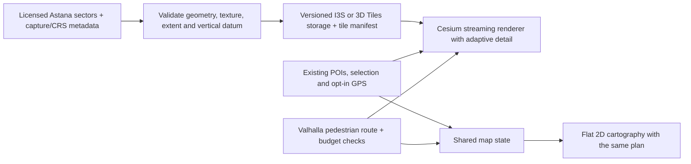

# Astana 3D map: research and implementation decision

> Later implementation: the user excluded 2GIS after an actual municipal Cesium attempt failed. Native Yandex Maps v3 is now implemented; owned-key activation remains pending. The public widget failed its in-app geometry gate. See [current implementation](yandex-map-implementation.md). Recommendations below retain their original research context.

Researched on 19 October 2026 using Exa, primary documentation, live municipal APIs, inspected OpenStreetMap records, provider-hosted SDK previews and an actual municipal scene package. This document supersedes the earlier landmark-patch approach.

The [expanded follow-up](astana-3d-exhaustive-findings.md) adds 252 discovery results across four further workstreams, direct alternate-service checks, current provider-access paths, supplier/model qualification and production acceptance gates. It also records the additional Yandex GPS/free-license qualification; the immediate 2GIS and licensed municipal-mesh decisions remain unchanged.

## Decision

**For Qala's interactive walking map, 2GIS is the strongest verified immediate choice. For a photorealistic city experience under our control, obtain Astana's existing municipal mesh and stream it with Cesium.** These are different deliveries, with different access requirements.

The municipal model is real: the public scene contains **374 integrated-mesh references**, including 57 grouped under 2024. Six public scene packages contain actual textured geometry. The city streaming server currently fails, the downloadable samples do not cover Bayterek or alem.ai, and the metadata does not establish reuse rights. This makes the municipality an actionable data acquisition lead, rather than an immediately available full-city replacement. [Municipal evidence](astana-3d-municipal.md), [actual scene JSON](https://gis.esaulet.kz/portal/sharing/rest/content/items/b535181687714acb87d95950844aed6a/data?f=pjson)

2GIS's official SDK preview directly rendered alem.ai's curved sphere and top aperture, and Bayterek's gold sphere and white lattice. It supplies the models through the same SDK supported by the new integration. Its project key is still required; the preview's credentials were never copied into Qala. [SDK evidence](astana-provider-coverage.md), [official playground](https://platform.2gis.ru/en/playground/mapgl/)

No inspected source establishes a freely reusable, current, photorealistic mesh of all Astana that can simply be dropped into this application. That conclusion is bounded by the investigated sources; it is not proof that no private or unpublished dataset exists.

## Why the previous map failed, and why 3D disappeared

The old map extruded two-dimensional building footprints using height attributes. A circular footprint therefore became a cylinder. A renderer cannot infer a sphere, a hollow steel lattice or an asymmetric tent from that information alone.

The underlying data also has important gaps. Bayterek's elevated part is tagged `roof:shape=orb`; current OSM2World does not dispatch that shape. The alem.ai part is tagged `round`, which OSM2World interprets as a roof with a ridge. Its tagged diameter is 100 m, while the building's architect describes an 80 m modified sphere. Changing libraries without qualifying the data would reproduce another incorrect model. [Inspected records, code and controls](astana-3d-open-data.md), [architect's geometry description](https://www.smithgill.com/work/kazakhstan_pavilion_science_museum/)

The current application lost 3D because its no-key fallback was changed to locked 2D before a project key for the replacement SDK was available. That was a premature product transition. The hand-built Bayterek patch has been removed. A successful replacement must preserve usable 3D, routing and selection together; an unavailable connection prompt is not completion of that requirement.

## What the candidate systems actually provide

| Option | Astana-specific evidence | Access and suitability |
| --- | --- | --- |
| **2GIS MapGL** | Five of seven inspected landmarks have detailed models: alem.ai, Bayterek, Khan Shatyr, Opera and the Triumphal Arch. Circus remains cylindrical; Kazakh Eli's column was not visible in the tested views | Strongest verified immediate material fidelity, with documented gaps. Requires the project's own Map Tiles API key; demo and production plans have different limits. Curated architectural models do not imply photogrammetry of every building. |
| **Yandex Maps JS API v3** | Official SDK example renders real curved alem.ai and detailed Bayterek geometry. The inspected SDK style uses plain building materials; consumer-map colour/texture parity was not demonstrated | Credible alternative, including a conditional free public-project offering. Requires an own key and applicable regional terms. See the [SDK comparison](astana-3d-sdk.md). |
| **Yandex public widget** | A real sphere mesh is visible without a project key | Useful interactive preview. A cross-origin widget cannot supply Qala's existing marker events and exact Valhalla route overlays through the inspected interface. It is not a seamless main-map substitute. |
| **Astana municipal I3S mesh** | 374 real mesh references; actual packages decoded and one downloaded and CRC-verified | Strongest route to photorealistic local ownership. Streaming repair or licensed delivery, central-area coverage, capture dates and data rights remain necessary. |
| **Google Photorealistic 3D / Cesium with Google data** | Google's country table lists Kazakhstan without 3D surface coverage | Not a source of the missing Astana architecture. Worldwide terrain does not imply worldwide building mesh. [Country coverage](https://developers.google.com/maps/coverage), [terrain/surface distinction](https://developers.google.com/maps/documentation/javascript/3d/coverage) |
| **Mapbox Standard** | Its live demo rendered alem.ai as a cylinder during inspection | No demonstrated improvement for the user's failing landmark. Global landmark marketing is not Astana coverage evidence. [Official demo at the building](https://labs.mapbox.com/standard-style/?lightPreset=day#17/51.08921/71.41607/-18/58) |
| **Cesium OSM Buildings** | Global OSM-derived building layer, including estimated heights where necessary | Valuable urban context, not a verified detailed Astana landmark dataset. Cesium can render better source data, but changing to Cesium alone does not create it. [Provider description](https://cesium.com/platform/cesium-ion/content/cesium-osm-buildings/) |
| **OSM2World / OSM Buildings** | Richer roof/part support; actual target data still fails known shape and dimension checks | Best open procedural research direction. Does not meet the requested accuracy without additional qualified models/data. [Open-data investigation](astana-3d-open-data.md) |
| **3DMR** | A working geographic/title API returned no Astana models; Eiffel Tower positive control succeeded | No located ready Astana landmark collection was found. This does not rule out unlocated or differently named models. [Retained API checks](evidence/astana-3dmr-coverage.json) |
| **Vexcel 3D Cities** | Current published city list covers other regions and does not list Astana | Do not assume Astana is included in a ready dataset. Custom availability would require a supplier response. [Provider inventory](https://vexceldata.com/products/3d-cities/) |
| **Free/paid city-model marketplace assets** | The inspected free Astana model preview is uniform block buildings; another listing explicitly warns about simple cubes/misalignment | A downloadable mesh is not sufficient evidence of accurate architecture, georeferencing or update quality. [Asset assessment](astana-3d-open-data.md) |

Detailed SDK access, regional limits, graphics presets, wider landmark checks and browser evidence are recorded separately in [the SDK workstream](astana-3d-sdk.md). No accounts, purchases, subscription changes or third-party messages were made.

For cost comparison, the inspected 2GIS Kazakhstan calculator showed **49,440 KZT/month for a selected 100,000 Map Tiles requests/month**. This is a dated, specific configuration, not a per-user price or a universal quote. Its demo is time-limited. Yandex has a conditional free public-project offering; the applicable Kazakhstan account terms and key must be checked. Either SDK still needs a project-owned key. The SDK report links the calculator, captured quote and regional terms.

## The photorealistic data that was actually found

The main municipal scene is a 2024-modified Web Scene with model groups labelled 2020, 2021, 2022 and 2024. These labels are not independently verified flight dates or coverage area measurements. Its 374 references may overlap.

The six public SLPKs range from **21 MB to 5.6 GB**. Their actual metadata contains triangular meshes, texture resources and a spatial hierarchy. Older examples are ContextCapture I3S 1.5 with WGS84 longitude/latitude and **EGM96 heights, EPSG:5773**. Two newer packages use I3S 1.8, Draco geometry and **EGM2008 heights, EPSG:3855**. None of the six package extents contains the two rejected landmarks. [Package table and measured responses](astana-3d-municipal.md)

The 21 MB sample was downloaded only for local research, verified across 6,681 ZIP entries, and kept in the ignored private research directory. Its full extent is approximately 71.41016–71.53558° E, 51.20609–51.22394° N. A source filename containing `20cm` is not an independent accuracy measurement.

An actual local compatibility pilot then loaded this I3S 1.5 package with **CesiumJS 1.146.0**, without an API key. It rendered source geometry and textures with no captured JavaScript/render errors. The private captures show sparse ground patches, not a usable architectural city or either target landmark. This proves the decoder/serving path for one package; it does not qualify its coverage, fidelity or heights. The [local proof report](astana-i3s-local-proof.md) and [reproducible loopback viewer](../../scripts/research_mesh_preview.py) record the scope. A research viewer is running at `http://127.0.0.1:8183/` while its local process remains active.

Public access flags and a successful download do not settle web redistribution, conversion or self-hosting rights. The actual package `licenseInfo` fields are null. The best identified acquisition path is the city's Architecture and Urban Planning Department and the original developer, KazAeroSpace. A concrete [data request](astana-3d-data-request.md) is prepared, but has not been sent. [Original developer's project](https://kazaerospace.kz/projects/card/9)

## Architecture for the application map

Keep the current assistant, planner, POIs, saved places and pedestrian router independent from the map provider. A shared map contract owns route geometry, selected place ID, starting point, viewport insets and opt-in GPS position. Provider changes must not reset the conversation or substitute a different route.

Load the active renderer lazily and keep only one live map/WebGL context. A fallback renderer should load when needed, rather than forcing both mapping stacks into initial startup. Keep selected stop, route and view state outside the renderer so a recoverable provider failure does not recreate the whole product.

For the immediate 2GIS delivery:

1. Use an authorized origin-restricted Map Tiles API key and the default style whose actual models were inspected. Preserve the provider logo and credits.
2. Render the existing Valhalla coordinates as the route overlay; retain numbered, keyboard-operable HTML markers and their selection callbacks. Do not replace the route silently with a widget's independently computed directions.
3. Use a model-enabled graphics preset. Validate the full landmark asset after loading; a temporary cylinder while assets stream must not be accepted as a completed result.
4. In 2D, hide mesh models and every raised geometry layer, then set pitch and bearing to zero. In 3D, restore the recorded layers. An overhead camera by itself is insufficient.
5. Fit the route into the area left by the assistant, cards and context bar. Keep camera transitions interruptible and reduced-motion aware. GPS must retain the existing explicit consent and watcher cleanup.
6. Separate missing key, rejected access, style failure and unavailable network. Preserve the plan and offer an explicit working fallback. Do not remove a previously working mode before its replacement is verified.

The integration already follows most of this contract, but its valid-key application session remains unverified. Code/types and public SDK preview tests are useful evidence; they are not a substitute for that final session.

## Architecture for a licensed photorealistic city

Use **CesiumJS with native I3S support first** when the licensed delivery is I3S. That avoids introducing an unnecessary geometry conversion before the source is qualified. A supported municipal service, or an authorized local SLPK service, supplies the actual mesh. The renderer should load spatial levels of detail rather than a single entire-city GLB. [I3SDataProvider](https://cesium.com/learn/cesiumjs/ref-doc/I3SDataProvider.html), [SLPK serving tool](https://loaders.gl/docs/modules/tile-converter/cli-reference/i3s-server)

The engineering details that determine whether this works:

- **Qualify each sector.** Store its source, capture date, extent, I3S version, horizontal and vertical reference system, licence reference and checksum. Exclude duplicate/older surfaces deliberately. A registry entry's broad extent is not enough.
- **Correct the vertical datum.** The older downloaded sample uses EGM96. Do not apply an EGM2008 tutorial's grid to it indiscriminately. Ground-relative heights and WGS84 ellipsoidal heights require the correct transformation before mixing terrain, sectors, pins or route surfaces. [EPSG:5773](https://epsg.org/crs_5773/EGM96-height.html), [Cesium height conversion architecture](https://www.esri.com/arcgis-blog/products/developers/3d-gis/ogc-i3s-cesiumjs)
- **Check the actual format.** Cesium documents I3S 1.6/1.7/1.8; the local 1.146.0 pilot successfully decoded this particular 1.5 package through its legacy path. Retain that version-specific empirical result rather than claiming all 1.5 packages are supported. Esri publishes a converter for older SLPKs if another sample needs upgrading; validate its output with the chosen client. [Compatibility proof](astana-i3s-local-proof.md), [converter documentation](https://github.com/Esri/i3s-spec/blob/master/i3s_converter/i3s_converter_ReadMe.md)
- **Convert only for a concrete reason.** 3D Tiles is useful for portability and content hosting. loaders.gl supports I3S/3D Tiles conversion, with a published feature matrix. Preserve source metadata and compare silhouettes, textures and bounds after conversion. [Supported features](https://loaders.gl/docs/modules/tile-converter/cli-reference/supported-features)
- **Keep navigation on the walking surface.** A photogrammetric mesh contains roofs, cars, vegetation and ground together. Indiscriminate route clamping can put a route on a roof. Use the pedestrian graph and a qualified ground-surface policy, with visible endpoint-offset caveats. Cesium provides several draping targets; the target must reflect what the line means. [Draping options](https://cesium.com/learn/cesiumjs-learn/drape-and-style-vector-data-on-terrain-and-3d-tile/)
- **Separate picking from mesh appearance.** A continuous mesh may lack meaningful per-building IDs. Keep the sourced POIs and optional qualified building footprints as a semantic layer, instead of pretending a texture triangle identifies a venue or entrance.
- **Stream and measure.** Use bounded tile/texture caches, adaptive screen-space error and worker decoding. Render on demand when idle. Avoid permanent repaint loops for a static city. [Explicit render mode](https://cesium.com/learn/cesiumjs/ref-doc/Scene.html)
- **Preserve the existing product.** The assistant, route budget, source evidence, saved places, GPX and GPS lifecycle remain the same. The map gains real geometry; it should not become an unrelated 3D viewer inside the app.

If retaining MapLibre is more valuable than native I3S support, MapLibre's official Three.js/3D Tiles example provides a legitimate integration path after conversion. It requires ownership of geospatial transforms, loader disposal, texture decoding and the shared depth buffer. That extra engineering makes it a second choice for an I3S-first municipal delivery. [Official 3D Tiles example](https://maplibre.org/maplibre-gl-js/docs/examples/add-3d-tiles-using-threejs/)

## Acceptance conditions before calling the map accurate

These are proposed project gates, not performance results or vendor accuracy claims.

| Gate | Required evidence |
| --- | --- |
| Landmark geometry | Orbit alem.ai, Bayterek, Khan Shatyr, Palace of Peace, major mosques, Opera, Triumphal Arch and Circus after assets settle. Compare silhouettes, openings, scale and placement to primary photographic/architectural references. Do not infer untested landmarks from two successes. |
| Coverage | A sector index proves the walking area is covered; holes and older sectors are identified. A northern sample does not prove EXPO coverage. |
| Ground alignment | No floating/sunken buildings, doubled surfaces or visible sector seams. Verify the correct height datum and at least several independent control points. Record tolerances based on the supplied survey evidence. |
| Real 2D | No extruded walls, spheres, raised roads, terrain relief or residual depth shadows. Preserve route and selected stop through both transitions. |
| Functional continuity | Actual assistant result → same numbered pins/cards → same real street geometry → navigation/GPX; no stale-plan start, lost selection or leaked GPS watcher after a provider failure. |
| Loading and failure | Cold cache, slow network, missing model, invalid key, offline transition and WebGL context loss are exercised. No silent successful-looking empty map. |
| Desktop performance | Proposed target: sustained 50+ FPS during ordinary orbit on a named integrated-GPU laptop. Record p95 frame time, peak memory, downloaded bytes and model-ready time. |
| Mobile performance | Proposed target: sustained 30+ FPS on a named midrange Android device, without losing landmark geometry. Measure under a stated network profile; software-rendered browser QA is not a device benchmark. |
| Idle and motion | No needless continuous redraw when idle. Camera actions interrupt cleanly; reduced-motion and keyboard interaction work. |
| Data rights and freshness | Recorded display/caching/self-hosting/conversion permissions, attribution, sector capture dates and an update path. |

The current **21/21 browser checks** prove the no-key application's routes, assistant, saved places, mobile views and genuinely flat fallback. They do not prove valid-key 3D or photorealistic full-city coverage. [Browser report](../../artifacts/redesign-browser-verification.json)

## Concrete delivery sequence

1. Finish one authorized 2GIS application session at alem.ai and Bayterek, including route overlays, selection, 2D/3D transitions and a mobile viewport. The project key is the immediate missing input; code for the provider is already present.
2. Qualify the wider landmark list and asset-loading behaviour. If cost or free public-project requirements favour Yandex, run the same application contract against its verified SDK geometry and compare material fidelity before selecting it.
3. Acquire a municipal sample covering both landmarks and adjacent route streets, with explicit rights and sector metadata. Do not buy a city asset based on a skyline screenshot.
4. Extend the completed local decoder pilot to the licensed central-area sample, validate datum/mesh/texture quality, then demonstrate the existing walking route over the real scene. Keep it separate from production until these checks pass.
5. Select the permanent renderer from measured mobile performance and data access. Only then switch the application's default 3D experience. Keep a working rollback and preserve the shared map state.

Supporting workstreams: [municipal mesh](astana-3d-municipal.md), [open data and automatic geometry](astana-3d-open-data.md), [SDKs and access](astana-3d-sdk.md), [architecture search audit](astana-3d-architecture-search-audit.json). The new deep pass requested **360 Exa result slots across four workstreams** (57 architecture, 101 municipal, 112 open geometry, 90 SDK); the municipal workstream returned five fewer entries than requested. An additional failed eight-slot municipal request returned no results and is excluded from 360. These are discovery counts, not 360 unique or independently validated sources. Research model binaries remain private and excluded from the submission archive.
